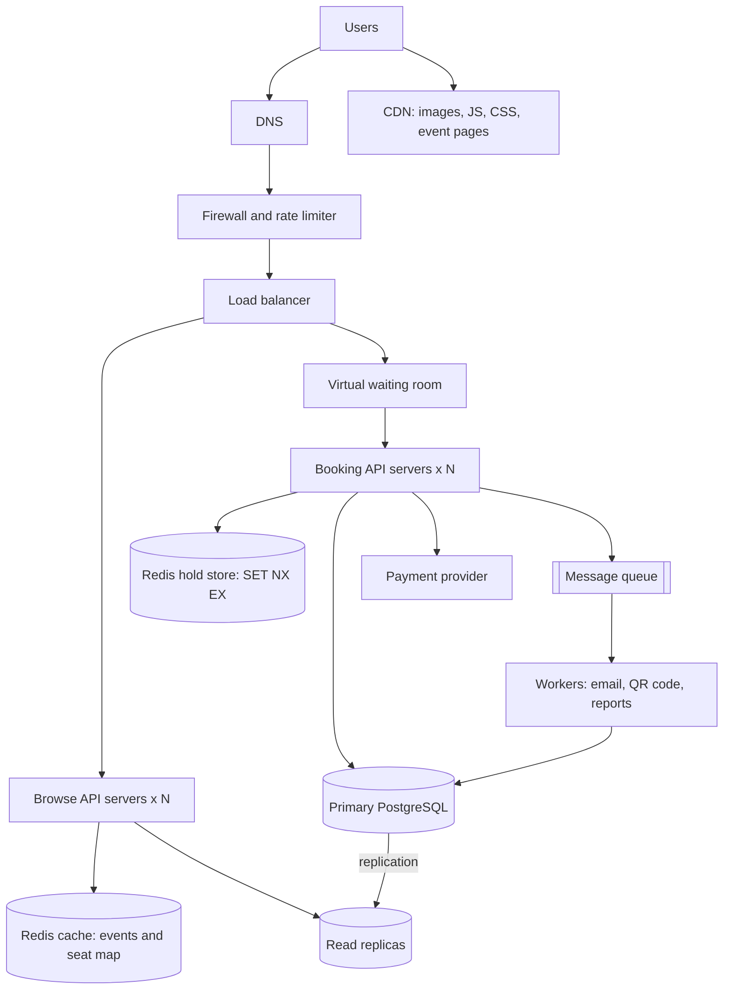

# TicketHub: Event Ticketing System Design

TicketHub sells tickets for concerts and events. This document follows the six-part framework: requirements, estimates, API, data model, architecture, trade-offs. Section 5 explains how two people can never buy the same seat.

## Design at a glance

- **Architecture:** Users -> DNS and CDN -> firewall and rate limiter -> load balancer -> virtual waiting room -> booking API servers (separate from browse API servers) -> Redis (cache and seat holds) and primary PostgreSQL with read replicas, plus a message queue with workers. The full diagram and every component are in Section 6.
- **No double-booking:** (1) a seat hold is one atomic Redis command, `SET hold:{event}:{seat} {hold_id} NX EX 300`, so only one of 500 simultaneous buyers wins; (2) payment is a PostgreSQL transaction using `SELECT ... FOR UPDATE` row locks, taken in `ORDER BY id` order to avoid deadlocks; (3) `tickets.seat_id` is UNIQUE, so the database refuses a second ticket for a seat. Details in Section 5.
- **Big sale (about 3,300 requests per second, 500x normal):** the CDN and cache absorb reads, the waiting room limits entry, and holds go to Redis so PostgreSQL only handles about 33 sales per second.
- **Trade-offs:** the waiting room (fairness against waiting time) and Redis holds (speed against running two stores). Two more are in Section 7.

## 1. Requirements

**Functional**
- Register and log in.
- Browse and search events.
- View an event's seat map (available, held, sold).
- Hold seats for 5 minutes, then pay.
- View my tickets.
- Organisers create events and set prices.

**Non-functional**
- **Correctness:** one seat, one buyer. Money is never taken for a seat the customer does not get.
- **Fairness:** people are served in the order they arrive. Bots and many tabs from one person should not win every seat.
- **Speed:** pages load in under 1 s. A seat hold answers in under 500 ms, even during a big sale.
- **Availability:** the site survives a big sale by queuing people instead of crashing.
- **Durability:** a paid order is never lost.
- **Security:** HTTPS everywhere. Card details go to the payment provider, never to our servers.

## 2. Estimates

Facts: 2M registered users. Normal day: 50,000 visitors x 10 pages, 5,000 tickets sold. Big sale: 200,000 people try to buy 20,000 seats in 10 minutes (600 s). One day is 86,400 s. Normal peak is assumed to be 5x the average. In the sale, each buyer sends about 10 requests and tries 2 seats.

| Item | Normal day | Big sale (first 10 min) |
|------|-----------|-------------------------|
| Requests per second | 500,000 / 86,400 = about 6 (peak about 30) | 200,000 x 10 / 600 = about 3,300 |
| Seat hold attempts per second | negligible | 200,000 x 2 / 600 = about 670 |
| Successful sales per second | 5,000 / 86,400 = 0.06 (peak 0.3) | 20,000 / 600 = about 33 |
| People who get a ticket | most of them | 20,000 / 200,000 = 10% |

**Comparison:** the sale is about 500 times busier than a normal day, it hits one event and the same 20,000 seats, and 9 in 10 people will lose. So the design must protect the database from the spike, make hundreds of people fighting for one seat safe, and make losing fast and clear. Storage is small (about 1.8M tickets a year, roughly 1 GB), so the spike is the problem, not the size.

## 3. API

JSON over HTTPS. Protected endpoints need `Authorization: Bearer <token>`.

| Method | Path | Purpose | Success |
|--------|------|---------|---------|
| POST | `/auth/login` | Log in | 200 |
| GET | `/events?city=&date=&q=&page=` | Browse and search events | 200 |
| GET | `/events/{id}` | Event details | 200 |
| GET | `/events/{id}/seats` | Seat map with status of each seat | 200 |
| POST | `/events/{id}/holds` | Hold seats for 5 minutes | 201 |
| DELETE | `/holds/{hold_id}` | Release a hold | 204 |
| POST | `/orders` | Pay for a hold | 201 |
| GET | `/me/tickets` | View my tickets | 200 |

Hold request and response:

```json
{ "seat_ids": [8841, 8842] }
```
```json
{ "hold_id": "h_93f2", "seat_ids": [8841, 8842], "expires_at": "2026-11-05T18:05:00Z" }
```

If a seat is gone: `409 Conflict` with `{ "error": { "code": "seat_unavailable", "message": "Seat 8842 was just taken." } }`.

Pay request: `{ "hold_id": "h_93f2", "payment_token": "tok_abc123", "idempotency_key": "b7c1-44e0" }`. The idempotency key means a retry after a network failure never charges twice.

## 4. Data model

| Table | Columns | Keys |
|-------|---------|------|
| users | id, email, password_hash, name, created_at | PK id, email unique |
| events | id, name, venue, city, starts_at, sale_opens_at | PK id |
| seats | id, event_id, section, row_label, seat_number, price_cents, status (`available` or `sold`) | PK id, FK event_id, unique (event_id, section, row_label, seat_number) |
| orders | id, user_id, event_id, total_cents, status, idempotency_key, payment_ref, created_at | PK id, FK user_id, FK event_id, idempotency_key unique |
| tickets | id, order_id, seat_id, qr_code | PK id, FK order_id, FK seat_id, **seat_id unique** |

**Relationships:** a user has many orders; an event has many seats; an order has many tickets; each ticket is for exactly one seat, and a seat has at most one ticket. Users and events are many-to-many through orders and tickets.

```sql
CREATE TABLE tickets (
  id INTEGER PRIMARY KEY,
  order_id INTEGER NOT NULL REFERENCES orders(id),
  seat_id INTEGER NOT NULL UNIQUE REFERENCES seats(id),
  qr_code TEXT NOT NULL
);
CREATE INDEX idx_seats_event_status ON seats (event_id, status);
```

(The other tables are created in the same way from the columns above, with `seats.status` limited to `available` or `sold` by a CHECK constraint.) Holds are not stored in the main database. They live in Redis, for reasons explained next.

## 5. Preventing two people from buying the same seat

At 670 hold attempts per second, a "read the status, then write it" flag in the database is not safe, because two people can both read `available` before either writes. Updating a status column for every hold would also put heavy row contention on the primary database. So the design uses two stores, each doing what it is best at.

**Step 1: the hold is an atomic Redis operation (fast, in memory).**
Each hold is a key `hold:{event_id}:{seat_id}` with the value `hold_id` and a 300 second expiry:

```
SET hold:55:8841 h_93f2 NX EX 300
```

`NX` means "only set if the key does not exist". Redis runs one command at a time, so if 500 people send this for the same seat in the same second, exactly one gets OK and the other 499 get nothing and receive `409`. For several seats in one request, a small Lua script sets all keys or none, so no one is left with half an order. The 300 second expiry frees seats from people who walk away, with no cleanup job. Redis can do tens of thousands of these per second, so the 670 per second spike barely registers, and the primary database is not touched.

**Step 2: payment is a PostgreSQL transaction with row locks (correct, durable).**

```sql
BEGIN;
SELECT id, status FROM seats
 WHERE id IN (8841, 8842)
 ORDER BY id            -- same order for every request, so no deadlocks
 FOR UPDATE;            -- row locks: a second buyer waits here
-- app checks: both rows are 'available' AND Redis still shows this user's hold
INSERT INTO orders (...) VALUES (...);          -- unique idempotency_key
INSERT INTO tickets (order_id, seat_id, qr_code) VALUES (...), (...);
UPDATE seats SET status = 'sold' WHERE id IN (8841, 8842);
COMMIT;
```

- `FOR UPDATE` locks the seat rows, so a second transaction on the same seat waits and then sees `sold`.
- Always locking in `ORDER BY id` order stops two buyers with overlapping seats from waiting on each other in a circle (a deadlock).
- The payment provider is called before the transaction using the idempotency key. If the transaction fails, the order is refunded automatically, and the seat stays unsold for the next person.
- Everything commits together or rolls back together.

**Step 3: the database constraint is the last safety net.**
`tickets.seat_id` is UNIQUE. Even if Redis lost a key early, two servers raced, or there was a bug, the second insert would be rejected by the database and the transaction would roll back. The data stays correct whatever happens above it.

**If Redis fails:** all holds are lost, so people may have to select seats again. No seat is ever sold twice, because Steps 2 and 3 do not depend on Redis. Correctness lives in PostgreSQL, speed lives in Redis.

## 6. Architecture



- **Users:** web and mobile apps showing events and seat maps.
- **DNS:** gives the user the address of TicketHub.
- **CDN:** serves images, scripts and static event pages from nearby, so most browsing never reaches our servers.
- **Firewall and rate limiter:** blocks bots and caps requests per user and IP, which helps fairness.
- **Load balancer:** spreads requests over healthy servers and removes failed ones.
- **Virtual waiting room:** when a hot sale opens, people get a place in line by arrival time (a random draw inside the first few seconds, so a faster connection does not decide everything) and are let into booking in batches the system can handle. This turns 200,000 people at once into a steady stream.
- **Browse API servers:** search, event pages, seat map. Stateless, so more can be added before a sale.
- **Booking API servers:** holds and orders only, kept separate so seat map refreshes cannot slow down payments.
- **Redis cache:** keeps the seat map for 2 to 3 seconds, so thousands of refreshes cost one database read.
- **Redis hold store:** the atomic seat holds from Section 5, with automatic expiry.
- **Primary PostgreSQL:** the only place orders and sold seats are written, so locks and constraints are reliable.
- **Read replicas:** serve browse queries so the primary only handles important writes.
- **Message queue and workers:** after payment, the confirmation email and QR code are done in the background so the buyer gets a quick reply.
- **Payment provider:** takes card details so we never store them.

**How it survives the sale (3,300 requests per second):**
1. The CDN and cache absorb most reads, so far fewer than 3,300 per second reach the database.
2. The waiting room caps how many people reach booking at once.
3. Holds (670 per second) go to Redis, not PostgreSQL. The primary sees only about 33 sales per second, which one PostgreSQL primary handles easily.
4. Browsing and booking run on separate servers, so one cannot starve the other.
5. The sale time is announced in advance, so extra servers are started before it and removed after.
6. There are many copies of every stateless part. If the primary fails, a replica is promoted, and committed orders are safe.

## 7. Trade-offs

1. **Waiting room: fairness and safety against convenience.** It protects the system and gives a fair line, but people must wait and it is one more system to build and run. I accept the wait because a clear queue is better than a crashed site where bots win.
2. **Redis for holds: speed against complexity.** Holding seats in Redis is fast and removes contention from the main database, but it means two data stores must agree, and if Redis loses data, holds are lost. I accept this because PostgreSQL's row locks and the unique constraint still guarantee no seat is sold twice. The cost is a rare, harmless "please pick your seat again".
3. **Cached seat map: speed against accuracy.** A map up to 3 seconds old keeps the site fast, but a user may click a seat that was just taken and get a `409`. This is fine because the hold step is exact.
4. **5 minute hold: payment time against wasted seats.** A longer hold makes paying calmer but leaves seats locked if the buyer leaves. It can be cut to 2 or 3 minutes for very popular sales.
