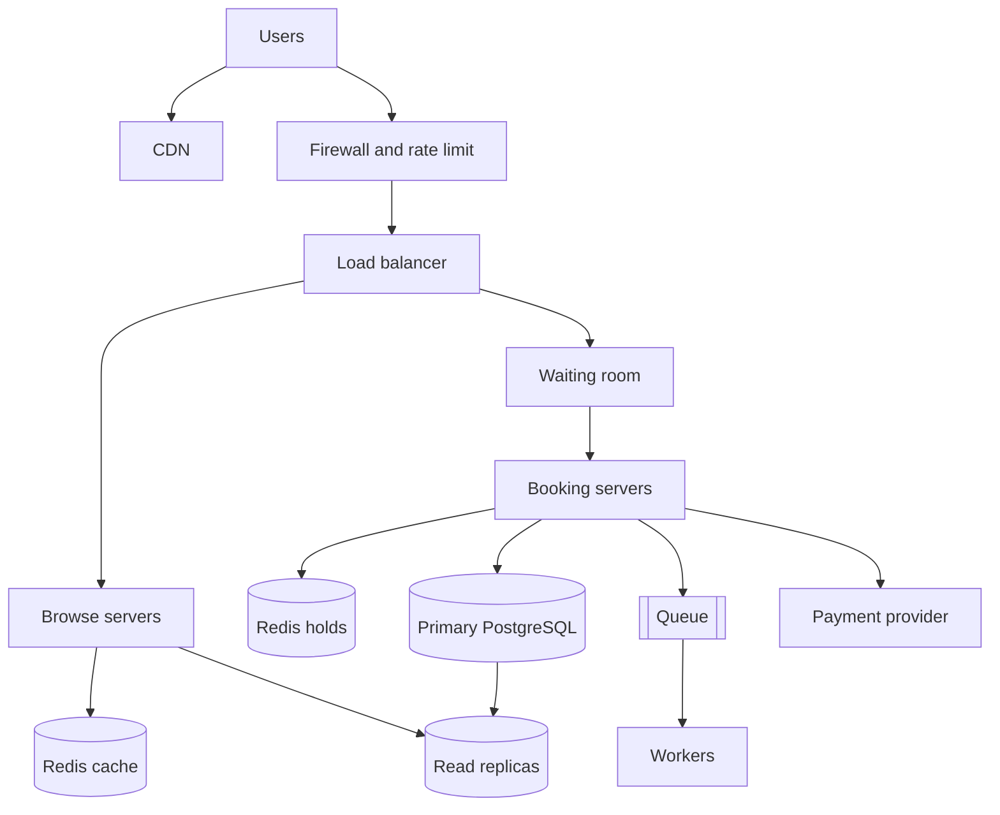

# TicketHub: Event Ticketing System Design

## 1. Requirements
Functional: register and log in, browse events, view the seat map, hold seats for 5 minutes, pay, view my tickets.
Non-functional: **correctness** (one seat, one buyer, never charge for a seat not delivered), **fairness** (first come, first served, bots limited), **speed** (browse under 1 s, hold under 500 ms), **availability** (survive the big sale by queuing, not crashing), **durability** (paid orders never lost), **security** (HTTPS, card data only with the payment provider).

## 2. Estimates
Normal day: 50,000 x 10 = 500,000 views / 86,400 s = about 6 per second (peak about 30 at 5x). Sales: 5,000 / 86,400 = 0.06 per second.
Big sale (600 s), with 10 requests and 2 seats tried per buyer: 200,000 x 10 / 600 = about 3,300 requests per second; 200,000 x 2 / 600 = about 670 hold attempts per second; 20,000 / 600 = about 33 sales per second; only 10% of buyers win.
Comparison: about 500 times a normal day, all on one event's 20,000 seats. The database must be shielded, and losing must be fast and clear.

## 3. API (JSON, Bearer token)
- POST /auth/login (200)
- GET /events?city=&q= (200); GET /events/{id} (200)
- GET /events/{id}/seats (200), the seat map
- POST /events/{id}/holds, body {seat_ids}, returns 201 {hold_id, expires_at}, or 409 seat_unavailable
- DELETE /holds/{id} (204)
- POST /orders, body {hold_id, payment_token, idempotency_key}, returns 201; a retry never charges twice
- GET /me/tickets (200)

## 4. Data model
users(id PK, email unique, password_hash); events(id PK, name, venue, starts_at, sale_opens_at); seats(id PK, event_id FK, section, row, number, price, status available or sold, unique on event, section, row, number); orders(id PK, user_id FK, event_id FK, total, status, idempotency_key unique); tickets(id PK, order_id FK, **seat_id FK UNIQUE**, qr_code).
One user has many orders, one event has many seats, one order has many tickets, one seat has at most one ticket.

## 5. Preventing double-booking
A read-then-write status flag is unsafe at 670 holds per second, so two stores share the job.
1. **Hold in Redis:** `SET hold:{event}:{seat} {hold_id} NX EX 300`. Redis runs commands one at a time, so of 500 simultaneous buyers one gets OK and 499 get a 409. A Lua script sets all seats of a request or none. The key expires after 300 s, so abandoned seats free themselves.
2. **Pay in PostgreSQL:** `BEGIN; SELECT ... FROM seats WHERE id IN (...) ORDER BY id FOR UPDATE;` (row locks, fixed order so no deadlocks), check the seats are `available` and that Redis still holds this user's key, insert the order and tickets, set seats `sold`, `COMMIT`.
3. **Constraint:** `tickets.seat_id` is UNIQUE, so a second ticket is rejected even if code or Redis fails.
Expiry during payment: a 5-minute timer can end while the user types card details. The payment step re-checks the Redis key first; if it expired and someone else holds the seat, the user gets a 409 before being charged. If it expired but nobody else took it, the key is re-created with SET NX and payment continues. If payment succeeds but the transaction fails, the payment is refunded using the idempotency key. If Redis crashes, holds are lost and users re-pick seats, but steps 2 and 3 still stop any double sale.

## 6. Architecture

CDN: serves images and static pages near the user. Firewall: blocks bots, limits requests per user. Load balancer: spreads traffic, drops failed servers. **Waiting room:** people join a line by arrival time (random order within the first seconds) and are let in only as fast as booking servers can handle, so 200,000 arrivals become a steady stream. Browse servers: search and seat map, kept separate so refreshes cannot slow payments. Redis cache: the seat map for 2 to 3 s. Booking servers: holds and orders. Redis holds: step 1 above. Primary PostgreSQL: the only writer of orders and sold seats. Read replicas: serve browse reads. Queue and workers: emails and QR codes after payment. Payment provider: handles cards.
Survival: CDN and cache absorb most of the 3,300 requests per second, the waiting room caps entry, holds hit Redis not PostgreSQL, so the primary sees only about 33 sales per second. Servers are added before the announced sale. A replica is promoted if the primary fails.

## 7. Trade-offs
1. **Waiting room:** fair and protective, but people wait and it is one more system to run. A clear queue beats a crash where bots win.
2. **Redis holds with PostgreSQL as truth:** fast and no write contention, but two stores to keep in step. Safe because the locks and the unique constraint still decide the final sale.
3. **Cached seat map:** speed against accuracy. A map 3 s old may show a taken seat, and the exact hold step returns a clear 409.
4. **5-minute hold:** calmer payment against locked seats. It can be cut to 2 or 3 minutes for hot sales.

A longer version with SQL, tables and examples is in `ticketing-design-extended.md`.
