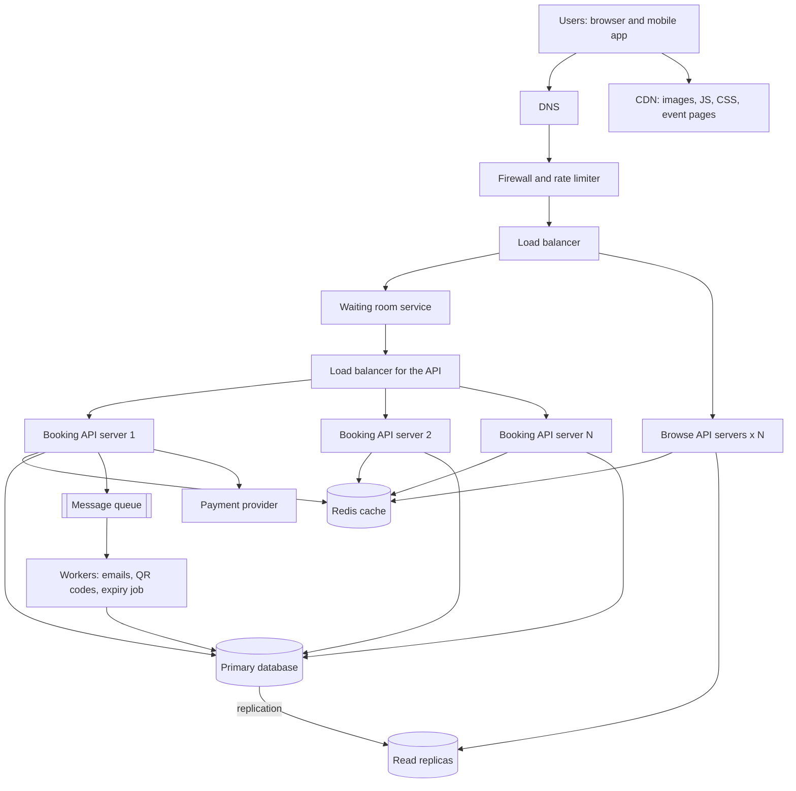

# TicketHub: Event Ticketing System Design

TicketHub is a website that sells tickets for concerts and events. This document follows the six-part framework: requirements, estimates, API, data model, architecture, and trade-offs. It also explains how the design stops two people from buying the same seat.

## 1. Requirements

### Functional
- Users can register, log in and log out.
- Users can browse and search events by name, date and city.
- Users can open an event and see its seat map, with each seat shown as available, held or sold.
- Users can hold seats for a short time (5 minutes) while they pay.
- Users can pay for held seats and receive tickets with a QR code.
- Users can see their past and upcoming tickets.
- Organisers can create events and set seat prices.

### Non-functional
- **Correctness (most important):** a seat can be sold to one person only. Money must never be taken for a seat the customer does not get.
- **Fairness:** when a popular concert opens, people are served roughly in the order they arrived. Bots and one person opening many tabs should not win every seat.
- **Speed:** browsing pages load in under 1 second. Holding a seat answers in under 500 ms, even during a big sale.
- **Availability:** the site stays up during a big sale. If part of it is overloaded, it slows down politely (a waiting room) instead of crashing.
- **Durability:** a paid order is never lost.
- **Security:** payments go through a payment provider, so card numbers never touch our servers. All traffic uses HTTPS.

## 2. Estimates

Facts: 2 million registered users, 50,000 visitors on a normal day with 10 page views each, 5,000 tickets sold on a normal day. For a big sale: 200,000 people try to buy 20,000 seats in the first 10 minutes. One day has 86,400 seconds, and I assume normal peak traffic is 5 times the average.

### Normal day

| Item | Calculation | Result |
|------|-------------|--------|
| Page views per day | 50,000 x 10 | 500,000 |
| Page views per second (average) | 500,000 / 86,400 | about 6 |
| Page views per second (peak) | 6 x 5 | about 30 |
| Ticket sales per second (average) | 5,000 / 86,400 | about 0.06 |
| Ticket sales per second (peak) | 0.06 x 5 | about 0.3 |

### Big sale (first 10 minutes = 600 seconds)

Assumptions: each of the 200,000 buyers sends about 10 requests in the window (refreshing the seat map, trying to hold seats, paying), and tries to hold 2 different seats on average.

| Item | Calculation | Result |
|------|-------------|--------|
| People arriving per second | 200,000 / 600 | about 333 |
| All requests per second | 200,000 x 10 / 600 | about 3,300 |
| Seat hold attempts per second | 200,000 x 2 / 600 | about 670 |
| Successful holds and sales per second | 20,000 / 600 | about 33 |
| Only 1 in 10 buyers can succeed | 20,000 / 200,000 | 10% |

### Comparison

A big sale brings roughly 3,300 requests per second, against about 6 on a normal day. That is more than 500 times the load, and it all lands on one event, and on the same 20,000 seats, within 10 minutes. Successful purchases go from 0.06 per second to about 33 per second, also around 500 times more. So the system cannot be sized for a normal day. It has to protect the database and the seats from a short, huge spike, and 9 out of 10 people will leave without a ticket, so that failure must be fast and clear too.

Storage is small: 5,000 tickets a day is about 1.8 million tickets a year, at roughly 500 bytes each, so about 1 GB a year. The challenge is the spike, not the size.

## 3. API

All endpoints use JSON over HTTPS. Protected ones need `Authorization: Bearer <token>`.

| Method | Path | Description | Success |
|--------|------|-------------|---------|
| POST | `/auth/login` | Log in and receive a token | 200 |
| GET | `/events?city=&date=&q=&page=` | Browse and search events | 200 |
| GET | `/events/{event_id}` | Event details | 200 |
| GET | `/events/{event_id}/seats` | Seat map with each seat's status | 200 |
| POST | `/events/{event_id}/holds` | Hold one or more seats for 5 minutes | 201 |
| DELETE | `/holds/{hold_id}` | Release a hold early | 204 |
| POST | `/orders` | Pay for a hold and create the order | 201 |
| GET | `/me/tickets` | View my tickets | 200 |

Hold a seat, request:

```json
{ "seat_ids": [8841, 8842] }
```

Response `201 Created`:

```json
{
  "hold_id": "h_93f2",
  "seat_ids": [8841, 8842],
  "expires_at": "2026-11-05T18:05:00Z"
}
```

If someone else already has the seat, the response is `409 Conflict`:

```json
{ "error": { "status": 409, "code": "seat_unavailable", "message": "Seat 8842 was just taken. Please pick another seat." } }
```

Pay, request (the payment token comes from the payment provider):

```json
{ "hold_id": "h_93f2", "payment_token": "tok_abc123", "idempotency_key": "b7c1-44e0" }
```

The `idempotency_key` means that if the phone loses signal and retries, the customer is not charged twice.

## 4. Data model

### Tables

| Table | Columns | Keys |
|-------|---------|------|
| users | id, email, password_hash, name, created_at | PK id, email unique |
| events | id, name, venue, city, starts_at, sale_opens_at, created_at | PK id |
| seats | id, event_id, section, row_label, seat_number, price_cents, status, held_by, hold_expires_at | PK id, FK event_id, unique (event_id, section, row_label, seat_number) |
| orders | id, user_id, event_id, total_cents, status, idempotency_key, payment_ref, created_at | PK id, FK user_id, FK event_id, unique idempotency_key |
| tickets | id, order_id, seat_id, qr_code | PK id, FK order_id, FK seat_id, **unique seat_id** |

`status` on a seat is `available`, `held` or `sold`.

### Relationships
- One user has many orders (one-to-many).
- One event has many seats (one-to-many). A seat belongs to one event.
- One order has one or more tickets (one-to-many), and each ticket is for exactly one seat.
- One seat has at most one ticket. The unique constraint on `tickets.seat_id` enforces this.
- Users and events are linked many-to-many through orders and tickets: a user can attend many events, and an event has many users.

### SQL

```sql
CREATE TABLE users (
  id INTEGER PRIMARY KEY,
  email TEXT NOT NULL UNIQUE,
  password_hash TEXT NOT NULL,
  name TEXT NOT NULL,
  created_at TIMESTAMP NOT NULL DEFAULT CURRENT_TIMESTAMP
);

CREATE TABLE events (
  id INTEGER PRIMARY KEY,
  name TEXT NOT NULL,
  venue TEXT NOT NULL,
  city TEXT NOT NULL,
  starts_at TIMESTAMP NOT NULL,
  sale_opens_at TIMESTAMP NOT NULL,
  created_at TIMESTAMP NOT NULL DEFAULT CURRENT_TIMESTAMP
);

CREATE TABLE seats (
  id INTEGER PRIMARY KEY,
  event_id INTEGER NOT NULL REFERENCES events(id),
  section TEXT NOT NULL,
  row_label TEXT NOT NULL,
  seat_number INTEGER NOT NULL,
  price_cents INTEGER NOT NULL,
  status TEXT NOT NULL DEFAULT 'available'
    CHECK (status IN ('available', 'held', 'sold')),
  held_by INTEGER REFERENCES users(id),
  hold_expires_at TIMESTAMP,
  UNIQUE (event_id, section, row_label, seat_number)
);

CREATE TABLE orders (
  id INTEGER PRIMARY KEY,
  user_id INTEGER NOT NULL REFERENCES users(id),
  event_id INTEGER NOT NULL REFERENCES events(id),
  total_cents INTEGER NOT NULL,
  status TEXT NOT NULL CHECK (status IN ('paid', 'refunded')),
  idempotency_key TEXT NOT NULL UNIQUE,
  payment_ref TEXT,
  created_at TIMESTAMP NOT NULL DEFAULT CURRENT_TIMESTAMP
);

CREATE TABLE tickets (
  id INTEGER PRIMARY KEY,
  order_id INTEGER NOT NULL REFERENCES orders(id),
  seat_id INTEGER NOT NULL UNIQUE REFERENCES seats(id),
  qr_code TEXT NOT NULL
);

CREATE INDEX idx_seats_event_status ON seats (event_id, status);
CREATE INDEX idx_orders_user ON orders (user_id, created_at DESC);
```

## 5. How double-booking is prevented

Two people clicking the same seat at the same moment is the main risk. The design uses three layers, so even if one fails the seat is still sold once.

**Layer 1: an atomic hold.** Holding a seat is one single UPDATE statement that checks and changes the seat together. It never reads the status first and then writes in a second step, because two people could both read "available" in between.

```sql
UPDATE seats
SET status = 'held', held_by = :user_id, hold_expires_at = :now_plus_5_min
WHERE id = :seat_id
  AND (status = 'available'
       OR (status = 'held' AND hold_expires_at < :now));
```

The database locks the row while the update runs, so if two requests arrive together, one runs first and the other then sees `held` and matches zero rows. The app checks the number of rows changed. If it is 1, the user got the seat. If it is 0, the app answers `409 Conflict`. For several seats in one request, all the updates run in one transaction, and if any seat fails, the whole transaction rolls back so the user never gets half of what they asked for.

**Layer 2: a transaction when paying.** The order is created inside one transaction: lock the seat rows with `SELECT ... FOR UPDATE`, confirm they are still held by this user and not expired, insert the order and tickets, set the seats to `sold`, and commit. If the payment provider fails, the transaction rolls back and the seats go back to the hold. Either everything happens or nothing does.

**Layer 3: a constraint as the last safety net.** `tickets.seat_id` is UNIQUE. Even if a bug in the code or two servers racing tried to insert a second ticket for the same seat, the database would reject it with an error. A rule in the database cannot be forgotten by a developer.

**Expired holds.** A hold lasts 5 minutes. A background job (and the `hold_expires_at < now` check above) frees seats from people who walked away, so seats do not stay blocked for ever.

**Safe retries.** The unique `idempotency_key` on orders stops a double click or a network retry from creating two orders for one hold.

## 6. Architecture



### Components
- **Users (client):** the web and mobile apps that show events and seat maps.
- **DNS:** finds the address of TicketHub for the user.
- **CDN:** serves images, scripts and the static parts of event pages from nearby servers, so most browsing traffic never reaches us.
- **Firewall and rate limiter:** blocks bots and limits each user and IP address to a sensible number of requests, which supports fairness.
- **Load balancers:** spread requests over healthy servers.
- **Waiting room:** when a popular sale opens, users get a place in a queue in the order they arrived (with a random draw for those arriving in the same first seconds) and are let into the booking system in small batches. This turns 200,000 people at once into a steady flow the database can handle.
- **Browse API servers:** handle search, event pages and seat maps. They are stateless, so more can be added quickly.
- **Booking API servers:** handle holds and orders. They are also stateless and are kept separate from browsing, so a flood of seat map refreshes cannot slow down payments.
- **Redis cache:** stores event details and the seat map for a few seconds, so thousands of people refreshing the map cost one database read instead of thousands.
- **Primary database (PostgreSQL):** the only place seats are changed, which is what makes the locking and constraints reliable.
- **Read replicas:** answer browsing queries so the primary only does the important writes.
- **Message queue and workers:** after payment, slow jobs (confirmation email, QR code, releasing expired holds) run in the background so the buyer gets a quick answer.
- **Payment provider:** takes the card details so we never store them, and sends back a token and result.

### How it survives the big sale
1. The CDN and cache take most of the read load, so the 3,300 requests per second mostly never reach the database.
2. The waiting room limits how many people reach the booking servers, so the primary database sees a controlled number of hold attempts instead of all 670 per second at once. Even 33 successful writes per second is easy for one PostgreSQL primary.
3. Booking and browsing run on separate servers, so one cannot starve the other.
4. Servers are added before a known sale starts (the sale time is announced), and extra capacity is not paid for on normal days.
5. Seat map reads can be a few seconds old, because the real check happens in the hold step. A user may click a seat that was just taken and get a friendly 409 message, but they are never sold a seat twice.
6. Losing a server is fine, because there are many of each type. If the primary fails, a replica is promoted, and holds and orders already committed are safe.

## 7. Trade-offs

1. **Waiting room: fairness and safety against convenience.** The waiting room protects the database and gives people a fair place in line, but it makes buyers wait and adds one more system to build and run. Without it, the fastest connections and bots would win, and the site could crash. I accept the wait because a clear queue is better than an error page.
2. **Cached seat map: speed against accuracy.** Showing a seat map that is a few seconds old keeps the site fast, but a person may click a seat that is already gone. I accept this because the hold step is exact and refuses the second buyer with a clear message. A real-time map would need the database to be hit on every refresh.
3. **Seat holds: fairness to buyers against unsold seats.** A 5 minute hold gives people time to pay, but while a seat is held nobody else can buy it, and if the buyer leaves, the seat is wasted for 5 minutes. A shorter hold fills seats faster but makes payment stressful. Five minutes is a middle choice, and it can be shortened for very popular sales.
4. **One primary database: simplicity against scaling.** One primary makes locking and constraints easy and correct, but it is a limit on writes. For 33 sales per second this is plenty. If TicketHub grew many times bigger, seats could be split by event across several databases, because one event's seats never need to be locked together with another event's.
